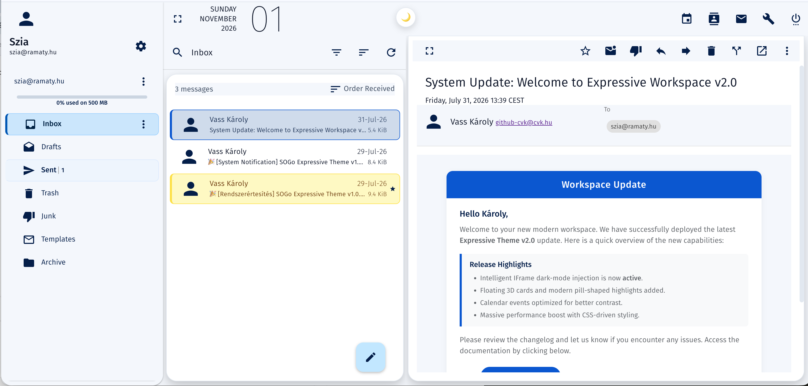

# SOGo Expressive Theme (v1.0.0)

A modern, clean, and elegant **Material 3 Expressive** theme for **SOGo Webmail 5.x**.

## ✨ Features

- **Material 3 Palette:** Soft light-blue canvas (`#f4f7fc`) with active blue accents (`#c2e7ff` & `#d3e3fd`).
- **Floating Card Layout:** Middle email list card and right detail panel float seamlessly above the background canvas.
- **Capsule Item Selections:** Two-sided rounded capsule selections (`24px` radius) for sidebar folders and mail list items.
- **Smart Unread Folder Highlighting:** Folders containing unread emails automatically illuminate with a soft ice-blue capsule (`#eaf1fb`) and bold typography.
- **Dark Navy Typography & Icons:** High-contrast, legible dark blue text (`#041e49`) and dark icons throughout the interface.
- **Custom Quota Progress Bar & FAB:** Modernized quota progress indicator and floating action button.
- **Pixel-Perfect Alignment:** All 3 main columns sit aligned on a single, uniform bottom baseline (`16px`).

## 🚀 Installation

### Option 1: Direct Integration in SOGo WebServerResources

1. Download the `sogo-expressive-theme.js` file from this repository.
2. Place the script inside your SOGo web resources directory:

   /usr/lib/GNUstep/SOGo/WebServerResources/js/sogo-expressive-theme.js

3. Include the script inside SOGo's HTML template or append it to your custom theme setup.

### Option 2: Injection via Web Server (Nginx / Apache) or Custom JS

If you are using a reverse proxy (Nginx or Apache) in front of SOGo, you can automatically inject the JavaScript file into SOGo's HTML output using `sub_filter` or custom Javascript inclusion headers.

Alternatively, add the script to SOGo's `Custom.js` if supported by your SOGo installation.

## 🎨 Color Palette Reference

| Component | Color Hex | Visual Role |
| :--- | :--- | :--- |
| **App Canvas** | `#f4f7fc` | Soft Light Grey-Blue Background |
| **Active Mail Capsule** | `#c2e7ff` | Active Email Row Highlight |
| **Active Folder Capsule** | `#d3e3fd` | Active Sidebar Folder Highlight |
| **Unread Folder Capsule** | `#eaf1fb` | Unread Folder Background |
| **Primary Text & Icons** | `#041e49` | Deep Navy Blue |
| **Hover State** | `#f1f3f4` | Soft Neutral Grey Capsule |

## 🛠️ Tech Stack & Compatibility

- **Target App:** SOGo Groupware 5.x
- **Framework:** AngularJS & Angular Material 1.x
- **Browser Compatibility:** Chrome, Edge, Safari, Firefox

## 📜 License

This project is released under the **MIT License**. Feel free to modify, distribute, and use it freely in your self-hosted SOGo installations.
