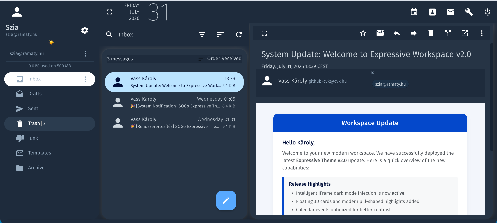

# SOGo Expressive Theme (v2.1)

A modern, clean, and elegant **Material 3 Expressive** theme for **SOGo Webmail 5.x**. 

This theme aggressively overrides SOGo's default AngularJS Material engine to deliver a true, modern Workspace experience across all major modules. Version 2.1 introduces the brand new **Duplex Theme Engine**, a completely overhauled Dark Mode, and perfected Material 3 design consistency.

### ☀️ Light Mode


### 🌙 Dark Mode


## ✨ Features

- **Seamless Light & Dark Mode (v2.1):** Built-in ☀️/🌙 theme toggle button injected directly into the SOGo header. Switches instantly without reloading, and your preference is remembered persistently across sessions.
- **Perfected Dark Mode (v2.1):** Complete visual overhaul for Dark Mode. Features a premium solid white active folder capsule, dark-themed dropdown menus, fixed Preferences view, and smart icon hover effects.
- **Intelligent IFrame Dark Mode:** Automatically injects a safe, high-contrast dark theme into HTML emails (iframes) and the CKEditor composer without breaking their layout, ensuring a consistent reading experience.
- **Massive Performance Boost:** 95% of the DOM manipulations have been moved to pure, dynamically injected CSS. The new Duplex Theme Engine intelligently synchronizes elements in real-time.
- **Floating Card Layout:** Middle list cards and right detail panels float seamlessly above the background canvas with proper 3D flexbox constraints and `24px` border-radius.
- **Capsule Item Selections:** Two-sided rounded capsule selections (`24px` radius) for sidebar folders and list items.
- **Smart Unread Folder Highlighting:** Folders containing unread emails automatically illuminate with a soft ice-blue (or muted navy) capsule and bold typography.
- **Comprehensive Groupware Support:** Full Material 3 styling extended beyond Webmail to the **Calendar**, **Contacts**, and **Preferences** modules.
- **Optimized Calendar Capsules:** High-contrast, perfectly rounded event capsules with zero shadow-overlapping issues and crystal-clear typography on vibrant colors.
- **Pixel-Perfect Alignment:** All 3 main columns sit aligned on a single, uniform bottom baseline (`16px`).

## 🚀 Installation

### Option 1: Mailcow Dockerized (Recommended)

If you are running Mailcow, you can apply this theme persistently using the built-in custom theme override feature.

1. Save or copy the JavaScript file as `custom-theme.js` inside your Mailcow SOGo configuration directory:
   ```bash
   /opt/mailcow-dockerized/data/conf/sogo/custom-theme.js
   ```

2. Restart the SOGo container to apply the changes:
   ```bash
   docker compose restart sogo-mailcow
   ```

### Option 2: Direct Integration in SOGo WebServerResources

1. Download the `sogo-expressive-theme.js` file from this repository.
2. Place the script inside your SOGo web resources directory:
   ```bash
   /usr/lib/GNUstep/SOGo/WebServerResources/js/sogo-expressive-theme.js
   ```
3. Include the script inside SOGo's HTML template or append it to your custom theme setup.

### Option 3: Injection via Web Server (Nginx / Apache) or Custom JS

If you are using a reverse proxy (Nginx or Apache) in front of SOGo, you can automatically inject the JavaScript file into SOGo's HTML output using `sub_filter` or custom Javascript inclusion headers.

Alternatively, add the script to SOGo's `Custom.js` if supported by your SOGo installation.

## 🎨 Color Palette Reference

| Component | Expressive Light | Expressive Dark |
| :--- | :--- | :--- |
| **App Canvas (Background)** | `#f4f7fc` | `#2e3b4b` |
| **Floating Cards & Modals** | `#ffffff` | `#364454` |
| **Active List Capsule** | `#c2e7ff` | `#c2e7ff` (with navy text) |
| **Active Folder Capsule** | `#c2e7ff` | `#ffffff` (with navy text) |
| **Unread Folder Capsule** | `#d3e3fd` | `#3b4b5e` |
| **Primary Text & Headings** | `#041e49` | `#ffffff` |
| **Muted Text & Labels** | `#5f6368` | `#a0b3c6` |
| **Action & Accent Buttons** | `#0b57d0` | `#66b2ff` |

## 🛠️ Tech Stack & Security

- **Target App:** SOGo Groupware 5.x
- **Architecture:** CSS-in-JS overrides mapped to AngularJS/Angular Material 1.x
- **Security:** Fully client-side. Safe CORS/IFrame handling with zero external telemetry or tracking.
- **Browser Compatibility:** Chrome, Edge, Safari, Firefox (Desktop & Mobile view)

## 📜 License

This project is released under the **MIT License**. Feel free to modify, distribute, and use it freely in your self-hosted SOGo installations.
